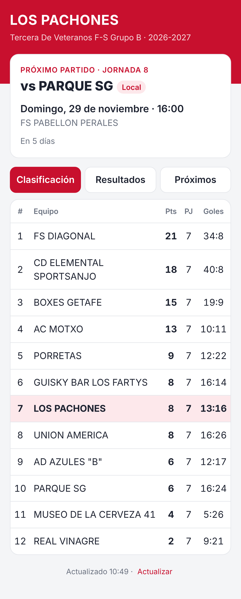
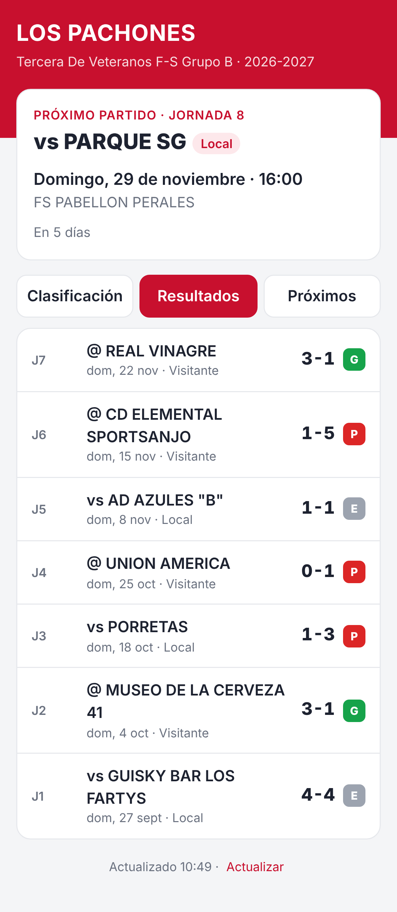
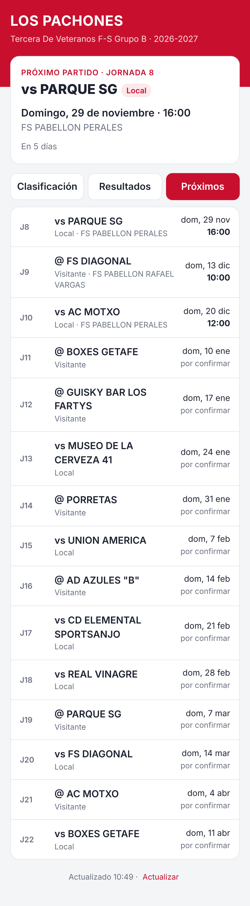

# NFG Getafe – Friendly View: Investigation Notes & Plan

> Status: **decision taken – serverless functions. Working prototype in this folder** (see [README](README.md)).
> Scope: **only LOS PACHONES** (Liga de Veteranos F-S, Tercera Grupo B). For the team's players: standings, results, upcoming matches.
> Target: `https://getafe.ffmadrid.es/nfg/` (Novanet "NFG" intranet, Competición Local de Getafe – RFFM)
> Account used for investigation: club user for **LOS PACHONES (club code 9028)**. Credentials are **not** stored in this repo.

---

## 0. Decision

| Requirement | Choice |
|---|---|
| Data must load **live** (no snapshots) | ✅ every view fetches from the federation site at request time |
| **No backend server** to run or maintain | ✅ a **serverless function** (Vercel) does login + fetch + parse per request |
| Keep it simple | ✅ one function (`api/nfg.js`) + one plain HTML page (`public/index.html`), no build step |

Rejected options, for the record:
- *Static page calling the site directly*: impossible (login cookie is HttpOnly + SameSite=Lax, not sent cross-site).
- *Snapshots / scheduled scraping*: not live → rejected.
- *Always-on proxy server*: works but needs a server → rejected.
- *Bookmarklet / userscript*: live and serverless, but every user must install it and log in themselves → kept as plan B.
- *Native app*: possible, but app stores + more work → kept as a later option.

  

---

## 1. What we observed

### 1.1 Platform
- Vendor product: **Novanet NFG** (Java servlet app behind Apache, `JSESSIONID` cookie, **ISO-8859-15** encoding).
- UI: Metronic/Bootstrap theme on a legacy jQuery app with `document.write`, hidden iframes and `javascript:` links.
- **Everything is server-rendered HTML.** No JSON API. Dropdown cascades return small HTML pages with `<script>` arrays.
- **All data pages require login.** Without a session every URL returns the login page with HTTP 200 (~21 KB, `<title>Novanet | Login</title>`), so "not logged in" is detected by content, not status code.

### 1.2 Login flow
| Step | Request | Notes |
|---|---|---|
| 1 | `GET /nfg/` | Sets `JSESSIONID` (Path=/nfg; Secure; HttpOnly; SameSite=Lax) |
| 2 | `POST /nfg/NLogin` body `NUser=…&NPass=…&LoginAjax=1&N_Ajax=1` | Returns `<script>var estado="1"…` on success (`"2"` or lower = bad credentials) |
| 3 | `GET /nfg/NPcd/<Procedure>?…` | Authenticated pages |
| – | `GET /nfg/NLogout?NURL=/nfg` | Logout |

**Session is tied to the TCP connection (verified).** Same cookie over a *new* connection → the server issues a new anonymous `JSESSIONID` and shows the login page. Same cookie over the *same* kept-alive connection → works.
On top of that the server sends **`Keep-Alive: timeout=2`**, so it closes a connection after 2 s idle.

Consequences for the function (all implemented in `lib/nfg.js`):
- All requests go over **one** connection (an undici `Client`).
- undici by default subtracts a 2 s safety margin from the server's keep-alive hint, which closes the socket after every response → we set `keepAliveTimeoutThreshold: 300`.
- After any idle gap > 2 s the next call sees the login page and **logs in again automatically** (~1.5 s extra). Calls made back to back reuse the session (~150 ms each).
- undici's `ProxyAgent` opens a new tunnel per request, so for local runs behind a proxy we open the CONNECT tunnel ourselves. Not needed on Vercel.

### 1.3 URL pattern
All screens are `/nfg/NPcd/<ProcedureName>?cod_primaria=<menuId>&…`. `cod_primaria` is the menu/permission id and is required.

### 1.4 Menu for this club user (read-only parts marked ✅)
| Section | Procedure | `cod_primaria` | Useful for the view |
|---|---|---|---|
| Mi Club | `NFG_VerMiClub` | 1000110 | ✅ club info, kit colours, teams |
| Licencias – Buscador | `NFG_LstLicencias` | 1000111 (`&Inicio=1`) | ✅ player licences (personal data!) |
| Documentos de Tramitación | `NFG_GC_DocumentosTramitacion` | 1001212 | ⚪ maybe |
| Gestión de Licencias | `NFG_GC_GestionLicencias` | 129 | ⛔ write actions |
| Directorio de Equipos | `NFG_LstDirectorioEquipos` | 1000165 | ✅ teams directory |
| Comparativa entre equipos | `NFG_LstComparativaEquipos` | 1001217 | ✅ head-to-head |
| Calendarios, Resultados y Clasificaciones | `NFG_CmpJornada` | 1000128 | ✅✅ **core** |
| Listado de Partidos (campos y horas) | `NFG_LstPartidos` | 1000139 | ✅✅ schedule, venues, times |
| Consulta de Sanciones | `NFG_ConsultaSanciones` | 1001218 | ✅ sanctions |
| Comunicación Online Sanciones | `NFG_CMP_LstCartasEquipos` | 1001219 | ✅ sanction letters |
| Liquidación online de clubes | `NFG_GC_LstLiquidaciones` | 1001202 | ⚪ club finances |
| Cambio de clave / firma, Correo Web | various | – | ⛔ out of scope |

### 1.5 Competition data model
IDs observed for season **2026-2027**:

```
temporada (season)         22 = 2026-2027, 21 = 2025-2026, 20, 19, 18, 17, 15
 └─ competicion            323306 = LIGA DE VETERANOS F-S
     │                     323297 AFICIONADOS F-11 · 323299 AFICIONADOS F-7 · 323311 AFICIONADOS F-S
     │                     344859 JUVENILES F-S · 345659 INFANTILES F-S · 346365 BENJAMINES F-S · 344802 FEMENINA F-S
     └─ grupo              323307 PRIMERA · 323308 SEGUNDA · 323309 TERCERA A · 323310 TERCERA B
         └─ jornada        1..22  (1 = 27-09-2026 … 22 = 11-04-2027)
             └─ partido (acta)   CodActa e.g. 67512
equipo                     Codigo_Equipo e.g. 308793
```

Cascade endpoints:
- Competitions of a season: `NFG_CmpJornada_Exec?cod_primaria=1000128&codtemporada=22&cod_agrupacion=&Sch_Tipo_Juego=` → injects a `<select>` as an HTML string (parsed from `<option>` tags).
- Groups of a competition: `NFG_CmpJornada_Exec?cod_primaria=1000128&codcompeticion=323306&cod_agrupacion=` → `new Array("id","label",…)`.
- Rounds of a group: `NFG_CmpJornada_Exec?cod_primaria=1000128&codgrupo=323307&cod_agrupacion=` → `new Array(…)`, labels like `"1 - 27-09-2026"`.

Data pages:
| Data | URL | In prototype |
|---|---|---|
| Results of a round | `NFG_CmpJornada?cod_primaria=1000128&CodCompeticion=C&CodGrupo=G&CodTemporada=T&CodJornada=J` | ✅ |
| Standings | `NFG_VisClasificacion?cod_primaria=1000128&codcompeticion=C&codgrupo=G&codjornada=J` | ✅ |
| Top scorers | `NFG_CMP_Goleadores?cod_primaria=1000128&codcompeticion=C&codtemporada=T&codgrupo=G&CodJornada=J` | ✅ |
| Full calendar | `NFG_VisCalendario_Vis?cod_primaria=1000128&codtemporada=T&codcompeticion=C&codgrupo=G` | next |
| Match sheet (line-ups, goals, cards, referee, venue) | `NFG_CmpPartido?cod_primaria=1000128&CodActa=A&cod_acta=A` | next |
| Team page | `NFG_VisEquipos?cod_primaria=1000102&Codigo_Equipo=E` | – (personal data) |
| Head-to-head | `NFG_LstComparativaEquipos?cod_primaria=1001217&competicion=C&grupo=G&equipo1=E1&equipo2=E2` | later |
| Match list with filters | `NFG_LstPartidos?cod_primaria=1000139&Sch_…` (~40 `Sch_*` filters) | later |

Built-in exports: `&NPcd_File=1` (Word) or `&excel=1&NPcd_File=1` (Excel) on calendar/standings/scorers. The body is HTML tables. A fallback if page templates change.

Result status on the site (CSS class → our `status`): `resultado_enjuego` → `live`, `resultado_prov` → `provisional`, `resultado_cerrada` → `final`.

### 1.6 Our team
"Mi Club" flags the team *"No está en competición"*, but that label is misleading: **LOS PACHONES (team id `308870`) plays in TERCERA DE VETERANOS F-S GRUPO B (`323310`)**, Liga de Veteranos F-S (`323306`), season 2026-2027 (`22`). Last season: competition `319435`, group `319439` (finished 3rd).

These IDs are the app's only configuration (`TEAM` in `lib/nfg.js`, overridable with env vars `NFG_TEAM_ID`, `NFG_SEASON`, `NFG_COMPETITION`, `NFG_GROUP`). **Each new season** they must be updated: open "Consulta de Calendarios, Resultados y Clasificaciones" on the site, choose the season → Liga de Veteranos F-S → the group, and read the ids from the URL (`CodTemporada`, `CodCompeticion`, `CodGrupo`).

### 1.7 Security / privacy notes
- Pages expose **personal data** (names, emails, phones of club contacts, player lists, line-ups). The API only exposes whitelisted views (results, standings, scorers) and is **not** an open proxy: fixed URLs, numeric parameters only.
- Scorers include player names. Acceptable for a private view; think twice before making it public.
- Optional `APP_KEY` env var: when set, the API requires `?key=…` (the page forwards `?key=` from its own URL).
- Credentials live only in the platform's environment variables (`NFG_USER`, `NFG_PASS`). Never in the HTML or the repo.
- The site reflects any `Origin` with credentials in CORS. A weakness on their side; we don't use it.
- Be gentle: the API sets `Cache-Control: s-maxage=60` so Vercel's CDN serves repeated requests for 1 minute. Check RFFM/Novanet terms of use before wider use.

---

## 2. Architecture (implemented)

```
 phone / browser                      Vercel                                  federation site
┌──────────────────┐  GET /api/nfg  ┌──────────────────────────────┐  HTML   ┌──────────────────────┐
│ public/index.html│ ─────────────> │ api/nfg.js  (serverless fn)  │ ──────> │ getafe.ffmadrid.es   │
│ plain HTML + JS  │ <───────────── │ lib/nfg.js: login, 1 conn,   │ <────── │ /nfg/NPcd/...        │
└──────────────────┘     JSON       │ parse with cheerio, re-login │         └──────────────────────┘
                                    └──────────────────────────────┘
                                      CDN cache 60 s (s-maxage)
```

API: `GET /api/nfg` (optionally `?key=…`). One call returns everything the page needs:

```json
{ "data": {
    "team": "LOS PACHONES", "group": "TERCERA DE VETERANOS F-S GRUPO B", "season": "2026-2027",
    "standingsAfterRound": 7,
    "standings": [{ "position": 7, "team": "LOS PACHONES", "points": 8, "played": 7, "won": 2, "drawn": 2, "lost": 3,
                    "goalsFor": 13, "goalsAgainst": 16, "form": ["P","P","E","P","G"], "teamId": "308870" }],
    "upcoming":  [{ "round": 8, "date": "29-11-2026", "time": "16:00", "venue": "FS PABELLON PERALES",
                    "home": true, "opponent": "PARQUE SG", "status": "scheduled" }],
    "results":   [{ "round": 7, "date": "22-11-2026", "home": false, "opponent": "REAL VINAGRE",
                    "goalsFor": 3, "goalsAgainst": 1, "outcome": "W", "status": "final" }] },
  "fetchedAt": "…" }
```

How it is built (5–7 requests to the site, all over one connection):
1. rounds of the group (dates) → pick the last round already played;
2. season calendar (`NFG_VisCalendario_Vis`) → all team matches; empty score cells = not played yet;
3. standings after the last played round;
4. round pages of the **next 3** matches → exact date, kick-off time, venue (later rounds: "por confirmar" until the federation schedules them), and of the **latest result** → provisional / live status.

Front-end: one page, Spanish, mobile-first, light/dark, no pickers. "Próximo partido" card on top (opponent, local/visitante, date, time, venue, countdown), then three tabs: **Clasificación** (our row highlighted), **Resultados** (newest first, G/E/P badge), **Próximos** (rest of the season). "Actualizar" button reloads. Can be added to the phone home screen.

Measured against the real site (from the sandbox): ≈ 3–3.5 s for the whole page with login (the CDN cache then serves repeats for 60 s).

---

## 3. Next steps

| # | Work | Status |
|---|---|---|
| 1 | Function + page for LOS PACHONES: next match, standings, results, upcoming | ✅ done, tested against the live site |
| 2 | **Deploy to Vercel** (needs your Vercel account): import repo, root dir `nfg-view`, set `NFG_USER`, `NFG_PASS` (+ optional `APP_KEY`) | ⏳ you |
| 3 | Verify the connection-bound session from Vercel's network (expected fine: one invocation = one connection) | ⏳ after deploy |
| 4 | Parser tests with saved HTML fixtures (so template changes are caught early) | todo |
| 5 | Home-screen icon (web app manifest) | todo, small |
| 6 | New season: update the 4 IDs (section 1.6) | each summer |

Netlify works too: wrap `handle()` from `lib/nfg.js` in a Netlify function. Only `api/nfg.js` changes.

---

## 4. Risks
- **Fragile scraping**: template changes on Novanet break parsers. Parsers are small and isolated in `lib/nfg.js`. Fixture tests (step 5) and the Excel export as fallback.
- **Connection-bound session**: handled (single connection + auto re-login). If a platform ever splits one invocation across egress IPs, calls would fail with "Session not kept by NFG after login". Verify after deploy.
- **Terms of use / account usage**: one real club account is used for all viewers. CDN cache keeps load low.
- **Personal data (GDPR)**: whitelist of views, optional `APP_KEY`, keep the URL private.
- **Vercel free tier limits** (function duration/invocations): far above what this needs.

---

## 5. Open questions
1. Who owns the Vercel account / where should it be deployed?
2. Private link with `APP_KEY` (recommended) or open?
3. Anything else the players want (e.g. match sheet with goal scorers)? Kept out on purpose for now.
